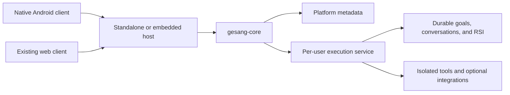

<p>
  <picture>
    <source media="(prefers-color-scheme: dark)" srcset="docs/assets/gesang-flower-dark.svg">
    
  </picture>
</p>

# gesang

A self-hosted personal cloud agent, starting with native Android chat.

gesang is being built for work that continues after you leave the conversation. Give your agent a goal, return to its progress, answer when it needs you, and collect the result. Your server owns execution; your phone is the interface.

## Development status

**Pre-release: implementation is in progress.** The project is not yet a runnable or production-ready distribution. There is no installable Android release or deployable standalone service yet. Passing individual checks does not establish the complete recovery, isolation, or mobile release guarantees.

See [architecture](docs/architecture.md) for ownership boundaries and [verification](docs/verification.md) for the evidence required before release.

## What we are building

- **Work that survives disconnection.** Goals remain in the cloud when a client closes. Restart recovery must continue the original work and reconcile uncertain actions before retrying them.
- **A personal agent.** Each person has a separate execution service, workspace, conversations, permissions, and learning records. Users join a deployment through administrator-managed access.
- **Continuous improvement.** Integrate [chopin-ai](https://github.com/CodePrometheus/chopin-ai) for durable execution and recursive self-improvement (RSI), including evidence, review, evaluation, adoption, budgets, and undo.
- **Chat across clients.** Android is the first native client. Existing web interfaces can reach the same agent through an embedded host, with shared identity and task references within that deployment.
- **Capabilities through plugins.** Add tools and business integrations through explicit permissions and lifecycle contracts. A plugin's service scope and its process isolation are separate concerns.

These are product requirements, not a list of completed features. Performance will be measured with equivalent durability, encryption, isolation, and workload; no benchmark or resource-capacity claim has been established.

## Architecture

The server has two intended host forms: a standalone service for self-hosting, or an existing application's backend embedding the same Rust kernel. Each agent has one controlling deployment and one effective storage writer.



The kernel owns delegated authorization, durable command delivery, runtime coordination, wake records, and plugin lifecycles. The execution service owns goals, conversations, tool journals, completion evidence, and learning records. Platform metadata does not maintain a second execution state machine.

The Android client combines a Rust client core, generated UniFFI bindings, and a Kotlin/Jetpack Compose interface. It handles drafts, device authentication, synchronization, and presentation; it does not keep cloud tasks alive.

Applications can embed the kernel and add domain capabilities through plugins. Standalone deployments use gesang independently. Application-specific interfaces and data remain with their hosts.

## Self-hosting

The deployment targets are a single Linux machine and an embedded Kubernetes environment, sharing the same authorization and recovery semantics. The intended trust model treats administrators as trusted, users as mutually untrusted, and tools as potentially hostile. Permission selection is explicit; Full access remains limited to the person's permitted resources.

Deployment packages, account setup, host custody integration, tool isolation, push configuration, and complete restart recovery still need implementation and verification. The shared [custody](docs/custody.md) and [configuration](docs/configuration.md) libraries have implementation and transactional tests. There is no supported installation procedure to follow yet.

## Repository guide

These paths contain implementation work; their presence does not establish completed or verified capabilities.

| Path | Contents |
| --- | --- |
| [`crates/gesang-api`](crates/gesang-api/) | Shared platform contracts |
| [`crates/gesang-core`](crates/gesang-core/) | Embeddable kernel, host interfaces, and transactional platform storage |
| [`crates/gesang-host`](crates/gesang-host/) | Internal control transport and shared execution connection adapters |
| [`crates/gesang-plugins`](crates/gesang-plugins/) | Scoped service dependencies and plugin lifecycle coordination |
| [`crates/gesang-client`](crates/gesang-client/) | Rust client transport and native binding interfaces |
| [`apps/android`](apps/android/) | Native Android project, theme, and localized resources; application flow is unfinished |
| [`xtask`](xtask/) | Shared development and verification entry points |
| [`scripts`](scripts/README.md) | Platform build helpers called through the task entry points |
| [`docs`](docs/) | [Architecture](docs/architecture.md), [API contracts](docs/api.md), [Rust conventions](docs/rust.md), and [verification requirements](docs/verification.md) |

## Development

Read the [contribution guide](CONTRIBUTING.md) and [Rust conventions](docs/rust.md) first. The repository pins its toolchain in [`rust-toolchain.toml`](rust-toolchain.toml) and shares dependency definitions in [`Cargo.toml`](Cargo.toml).

The workspace currently requires the in-development `chopin-protocol` and `chopin-job-broker` Rust crates from the sibling source checkout referenced in `Cargo.toml`. Public revisions and retrieval instructions for these crates have not been provided yet, so a fresh clone is not a reproducible standalone build. The [Android development notes](apps/android/README.md) describe its tooling. Debug application and instrumentation builds have passed; this does not establish release packaging or the complete cloud workflow.

For a configured development checkout, the Rust checks are:

```sh
cargo xtask help
cargo xtask check
```

Transactional integration tests are ignored by default. Set `GESANG_TEST_DATABASE_URL` to a dedicated test database with schema-creation privileges, then run:

```sh
cargo xtask test-store
```

This includes kernel persistence, custody, configuration, lifecycle, host control,
and command-broker authorization and output recovery. The broker cases use explicit
physical-worker fixtures; they do not verify operating-system containment or a
complete cloud task.

Native execution storage recovery has a separate integration entry point:

```sh
cargo xtask test-storage
```

It requires the same dedicated database plus `GESANG_TEST_STORAGE_PROBE`,
`CHOPIN_STORAGE_NATIVE`, and `GESANG_TEST_STORAGE_TIMEOUT_MS` identifying the real
execution probe, built native module, and explicit test deadline. It exercises process
interruption and commit acknowledgement loss rather than a simulated storage adapter.

First-store creation and existing-store reconciliation use:

```sh
cargo xtask test-initialization
```

This requires `GESANG_TEST_DATABASE_URL`, `GESANG_TEST_INITIALIZATION_PROBE`,
`CHOPIN_STORAGE_NATIVE`, and `GESANG_TEST_STORAGE_TIMEOUT_MS`. It runs the actual
initializer against shared HTTP custody and storage anchors, checking the encrypted
database, immutable operation marker, unchanged reconciliation bytes and original
completion receipt. Provider resource identities remain explicit test fixtures.

These are verification commands, not installation instructions or evidence that a release is ready. Record the checks actually run and any missing coverage when contributing.

## Contributing

Read the [contribution guide](CONTRIBUTING.md), [code of conduct](CODE_OF_CONDUCT.md), and [security policy](SECURITY.md). Public source comments and technical documentation are English; product text is localized.

## License

Licensed under [Apache-2.0](LICENSE).
