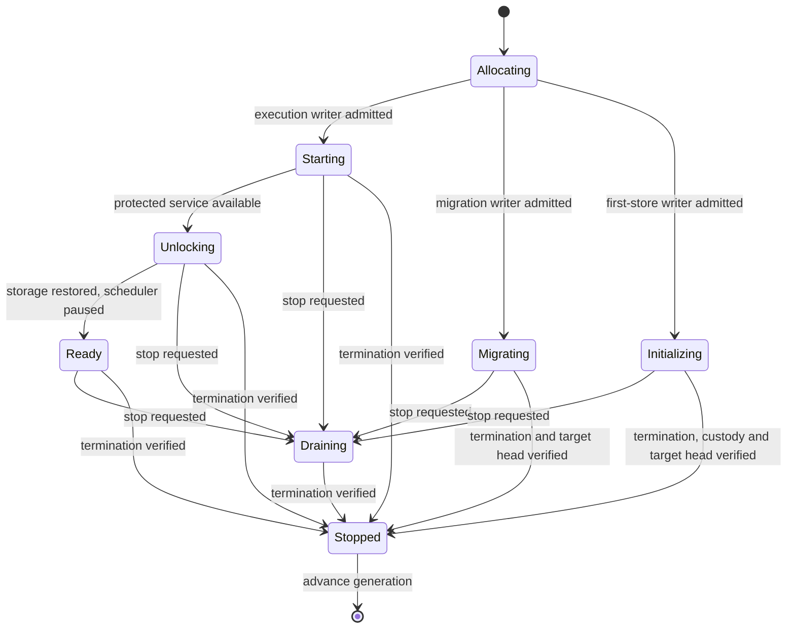

# Instance preparation

Instance lifecycle is platform metadata, separate from execution-owned goal state.
The controller persists an immutable nonsecret provider plan and a new runtime
identifier before changing infrastructure. Retrying an uncertain allocation uses
the same identifier and plan. Provider definitions pin image and configuration
references; they never contain credentials.

The provider first fences every previous writer and creates an actual allocation
with a startup barrier. Admission records that exact allocation before the provider
releases the barrier. A plan identifier alone is insufficient: protected storage
access requires the current admitted writer. Providers retain the stable allocation
identity and separately verify each concrete process incarnation. A missing or
unreachable allocation must never be recreated under the same admitted identity.

The admitted execution service may authenticate and recover storage while starting
or unlocking, but its scheduler stays paused. The shared connection adapter owns
the asynchronous unlock operation; the coordinator polls its progress and continues
renewing the same lease. Cancellation discards partial connection state. Retirement
and adapter shutdown cancel owned preparation operations. A process that terminates
during unlock is replaced only after independent termination evidence.

Ready enables public routing and an explicit scheduler resume. Every model or tool
effect still checks its current delegation and host policy. Draining rejects new
execution while allowing the protected writer to finish storage reconciliation.
Unavailable observations remain uncertain and retain recovery work.

A migration plan has a fixed migration purpose. Its admitted process can reconcile
storage anchors and request migration authorization, which independently rechecks
source fencing. It cannot resume a scheduler or use task or improvement grants.
Successful completion requires both actual termination and the exact confirmed
target anchor with no pending commit. The controller then advances the generation;
execution uses a different runtime identity. A stopped process with a recorded
problem is not a successful migration.

A first-store plan has a separate initialization purpose. Pending custody permits
only that preparation purpose. The initializer may receive the original service key
after actual admission, creates the encrypted store, and publishes custody only at
the confirmed closed head. It cannot become Ready in place. The provider verifies
its termination before a later generation starts an execution service against the
existing store.

Every stage transition uses the current controller claim, exact binding, persisted
plan, and revision in one durable transaction. Events record those revisions.
Recovery reads the persisted stage rather than planning again. Lease expiry revokes
logical authority but is never physical termination evidence. Durable wakes are
recorded with preparation intent and ready transitions, so client connections are
unrelated to continued coordination.

Database and transport fixtures verify these metadata rules. Actual provider gates,
process isolation, protected custody delivery, and deployed restart behavior require
independent infrastructure acceptance; metadata tests do not establish those facts.
